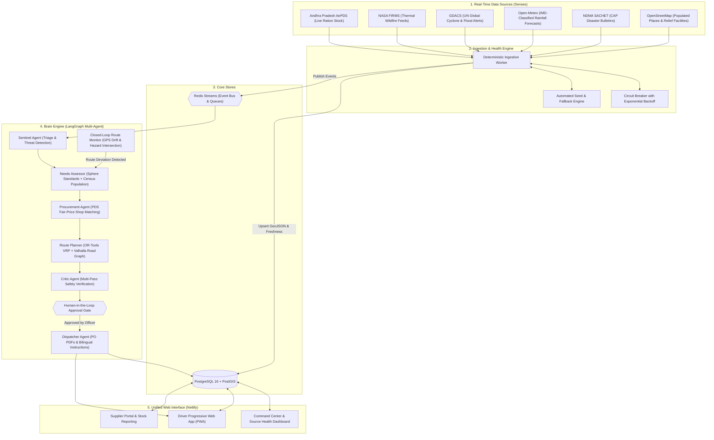
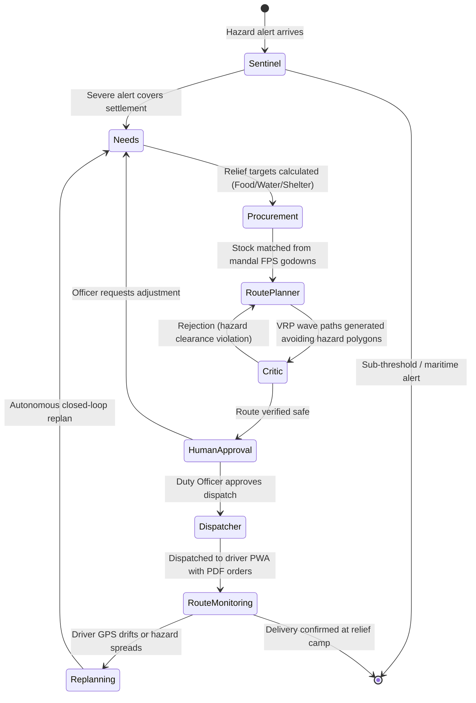
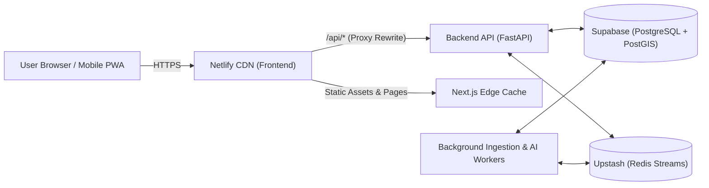

# SafePassage (ReliefRoute)

> **Autonomous, Resilient Disaster Relief Supply Chain & Multi-Agent Routing System**  
> Watches live disaster alerts across Andhra Pradesh, determines relief demand from Census populations, matches inventory against real government stock, calculates safe road routes avoiding hazard polygons, and dispatches them under human supervision.

[](https://nextjs.org/)
[](https://fastapi.tiangolo.com/)
[](https://postgis.net/)
[](https://aistudio.google.com/)
[](https://www.netlify.com/)

---


---

## Core Philosophy: LLMs Reason, Solvers Compute

Disaster relief operations require mathematical certainty. In SafePassage:
- **LLMs (Google Gemini 2.5 + LangGraph)** triage incoming hazard alerts, generate situation briefs for duty officers, verify rationale, and translate multilingual turn-by-turn guidance for drivers in Telugu and English.
- **Deterministic Solvers (Google OR-Tools & Shapely)** compute logistics, solve Vehicle Routing Problems (VRP), and guarantee that truck paths maintain strict spatial clearance from dynamic hazard boundaries.
- **The LLM never hallucinates a coordinate, distance, stock figure, or route.**

---

## System Architecture



---

## Multi-Agent Decision Pipeline (The Brain)



1. **Sentinel Agent**: Filters national feeds for Andhra Pradesh. If a severe hazard intersects a settlement, it triggers plan generation.
2. **Needs Assessor**: Intersects hazard footprint with Census 2011 population data to compute nutritional and survival requirements (Sphere standards: 2.1 kg rice, 0.4 kg pulses, 3L water/person/day).
3. **Procurement Agent**: Resolves stock against live Andhra Pradesh Civil Supplies (AePDS) fair-price shops across all 684 mandals.
4. **VRP Route Planner**: Solves capacitated vehicle pickups and deliveries through Google OR-Tools and Valhalla turn-by-turn routing around dynamic hazard polygons.
5. **Critic Agent**: Performs independent spatial intersection tests between routes and expanding hazard zones. Rejects any route infringing on the safety buffer up to 3 times before escalation.
6. **Human Approval Gate**: Zero high-stakes dispatches occur without explicit duty officer sign-off.
7. **Dispatcher Agent**: Produces tamper-evident purchase order PDFs, notifies drivers, and translates instructions into Telugu and English.
8. **Route Monitor**: Ingests high-frequency GPS fixes from driver phones. If road conditions deteriorate or a truck deviates, it triggers autonomous replanning.

---

## Live Data Sources & Health Monitoring

SafePassage features dynamic health monitoring with automatic recovery and zero synthetic fallbacks:

| Data Source | Provider | Frequency | Health Metric | Resilience & Fallback |
|---|---|---|---|---|
| **AePDS Ration Stock** | Andhra Pradesh Civil Supplies ePoS Portal | 24 hours | Closing balance of Rice & Pulses across all Fair Price Shops | Match against 684 OSM mandal boundaries; per-commodity retry |
| **NASA FIRMS Fires** | NASA VIIRS Satellite | 3 hours | Thermal active fire hotspots (FRP & confidence) | Bounds clipped to Andhra Pradesh region |
| **GDACS Global Alerts** | UN / European Commission | 1 hour | Tropical cyclone tracks, storm surge, flood alerts | National feed ingestion with polygon extraction |
| **Open-Meteo Forecast** | DWD / ECMWF / GFS Models | 6 hours | 0.5° spatial rainfall grid classified into IMD categories | IMD rainfall thresholds (Heavy, Very Heavy, Extreme) |
| **OpenStreetMap Places** | OpenStreetMap Community | 30 days | Settlements, cities, towns, and Census 2011 population | Built-in offline GeoJSON sequence bootstrap |
| **OpenStreetMap Facilities** | Overpass API | 3 days | Hospitals, schools, warehouses, fuel depots, shelters | Adaptive circuit breaker (60s backoff) + offline extract fallback |
| **NDMA SACHET** | National Disaster Management Authority | 2 minutes | Common Alerting Protocol (CAP) bulletins | Name normalization fallback to OSM admin boundaries |

---

## Deployment Architecture (Netlify + Cloud Backend)

SafePassage is designed for split deployment:
- **Frontend**: Hosted on **Netlify** (Next.js 16 with Turbopack, App Router, first-party cookie proxying).
- **Backend API & Workers**: Hosted on **Render** (or any Ubuntu Cloud VPS).
- **Database**: Managed **PostgreSQL 16 + PostGIS** (Supabase or Render).
- **Event Bus**: Managed **Redis** (Upstash or Render).



### 1. Backend Deployment (Render or VPS)

1. Connect your repository to Render using **Blueprint** (`render.yaml`).
2. Supply environment variables:
   - `DATABASE_URL`: Your PostgreSQL + PostGIS connection string (e.g. from Supabase).
   - `REDIS_URL`: Your Redis connection string (e.g. from Upstash).
   - `GEMINI_API_KEY`: Your Google Gemini API key from AI Studio.
3. Apply the blueprint. Render starts `reliefroute-api`, `reliefroute-ingestion`, and `reliefroute-brain`.

### 2. Frontend Deployment (Netlify)

1. In Netlify, click **Add new site** → **Import an existing project** from GitHub.
2. Select repository: `SafePassage`.
3. Set build configuration:
   - **Base directory**: `frontend`
   - **Build command**: `npm run build`
   - **Publish directory**: `frontend/.next`
4. Set environment variables in Netlify:
   - `API_ORIGIN`: `https://<YOUR-BACKEND-URL>` (without trailing slash)
   - `NEXT_PUBLIC_REGION_BBOX`: `76.6,12.5,84.9,20.1`
5. Configure API proxying in `netlify.toml`:
   ```toml
   [[redirects]]
     from = "/api/*"
     to = "https://<YOUR-BACKEND-URL>/api/:splat"
     status = 200
     force = true
   ```
6. Click **Deploy**. Netlify builds and hosts the application with zero CORS overhead.

---

## Local Development Quickstart

### Prerequisites
- Python 3.11 or 3.12
- Node.js 20 or 22
- Docker & Docker Compose

### 1. Start Infrastructure (PostGIS & Redis)
```powershell
docker compose up -d db redis
```

### 2. Set Up Backend
```powershell
cd backend
python -m venv .venv
.\.venv\Scripts\Activate.ps1

# Install requirements
pip install -e ..\contracts\python -r requirements\brain.txt -r requirements\senses.txt -r requirements\dev.txt

# Run migrations
python -m app.core.migrate

# Run one sync pass over all 6 data sources
python -m app.ingestion.worker --once

# Start API server
uvicorn app.main:app --reload --port 8000
```

### 3. Set Up Frontend
```powershell
cd frontend
npm install
npm run dev
```

Open [https://safepassage-frontend-git-main-labbe.vercel.app/](https://safepassage-frontend-git-main-labbe.vercel.app/) to view the live operations dashboard.

---

## Running Automated Tests

```powershell
cd backend

# Test resilience & circuit breaker backoff
pytest tests/brain/test_resilience.py

# Test data source health statuses (Operational, Stale, Paused, Never Synced)
pytest tests/senses/test_source_health_statuses.py

# Test live data source parsers
pytest tests/senses/test_other_sources.py tests/senses/test_aepds.py
```

---

## License

This project is licensed under the Apache 2.0 License.
